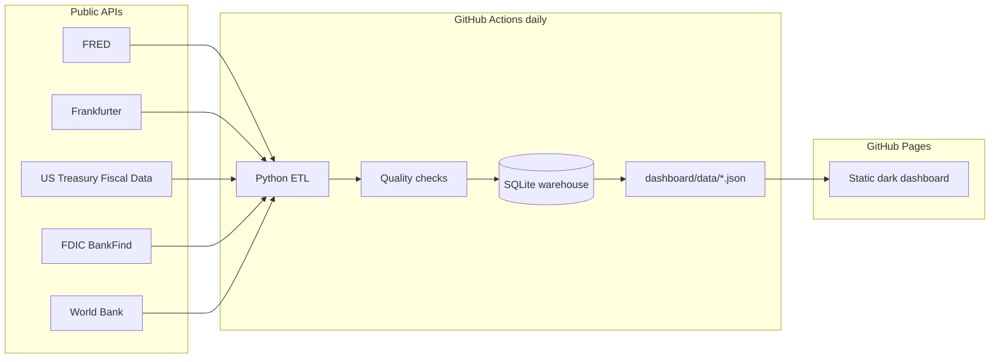

# Live Banking KPI Dashboard

Portfolio-ready **banking KPI dashboard** that refreshes itself daily from free public APIs. No stale Excel files — a static dark UI on **GitHub Pages**, data warehouse in **SQLite**, orchestration via **GitHub Actions**.

## Live demo

After deploy: `https://<github-user>.github.io/live-banking-kpi-dashboard/`

## What you see

- **Rates**: Fed Funds, SOFR, 10Y Treasury, 30Y mortgage, Prime (FRED)
- **FX**: USD crosses (Frankfurter / ECB)
- **Bank system**: assets, deposits, net income, ROA, NPL (FDIC BankFind)
- **Macro banking**: World Bank indicators + Treasury average interest rates
- **Data quality panel**: missing values, duplicates, odd values, freshness scores

## Architecture



## Where API keys live

| Secret | Local | GitHub |
|--------|--------|--------|
| `FRED_API_KEY` | `.env` (from `.env.example`) — **never commit** | Repo **Settings → Secrets → Actions** as `FRED_API_KEY` |

All other sources are keyless. Keys are **only** read in Python ETL / Actions — never embedded in the static dashboard.

```bash
cp .env.example .env
# edit .env and set FRED_API_KEY=...
```

## Folder structure

```
live-banking-kpi-dashboard/
├── etl/                 # extract, transform, quality, warehouse, pipeline
├── sql/schema.sql       # warehouse DDL + KPI views
├── dashboard/           # static site (Pages root)
│   ├── index.html
│   ├── assets/
│   └── data/            # kpis.json, quality.json, meta.json (generated)
├── tests/
├── postman/             # API collection
├── data/raw|warehouse   # local artifacts (gitignored DB)
└── .github/workflows/daily-refresh.yml
```

## Run locally

```bash
python -m venv .venv
# Windows: .\.venv\Scripts\Activate.ps1
pip install -r requirements.txt
cp .env.example .env   # add FRED_API_KEY
python etl/pipeline.py
pytest -q
# serve dashboard
python -m http.server 8080 --directory dashboard
# open http://localhost:8080
```

## Deploy (GitHub Pages)

1. Create public repo `live-banking-kpi-dashboard`
2. Push `main`
3. Add secret `FRED_API_KEY`
4. **Settings → Pages → Source: GitHub Actions**
5. Actions → **Daily KPI Refresh** → Run workflow

The workflow runs ETL, tests, commits fresh JSON, and deploys `dashboard/` to Pages.

## Tech choices

| Layer | Choice | Why |
|-------|--------|-----|
| Hosting | GitHub Pages | Free static, no sleeping server |
| Warehouse | SQLite | Zero ops, portable, SQL views for KPIs |
| ETL | Python + pandas | Analyst-friendly, easy CI |
| UI | HTML/CSS/Chart.js | Fast, dark, mobile-friendly, no build step |
| Schedule | Actions cron `0 12 * * *` | Daily free refresh |

## Postman

Import `postman/Banking_KPI_APIs.postman_collection.json` and set `FRED_API_KEY`.

## Disclaimer

Educational portfolio project using public data. Not financial advice.
